# Лабораторная работа № 4 — Amazon EC2: от статического сайта до TimeCapsule

**ФИО:** Мартынюк Петр * 
**Группа:** IA2404   
**Специальность:** Informatică aplicată  
**Уровень:** продвинутый (задания 1–14)  
**Приложение:** TimeCapsule — `open_capsules_php_functional` (PHP + PostgreSQL)  
**Способ деплоя:** вариант A — ручной `git pull` на EC2  
**Репозиторий:** https://github.com/cloudstudent-cloud/timecapsule  
**Регион:** `eu-central-1` (Frankfurt)  
**Экземпляр:** `webserver`, `t3.micro`, `i-0a2b5b3986624c494`  
**Дата работы:** 28–29 октября 2026 г.

## Цель и результат

Научиться запускать и контролировать EC2, подключаться по SSH, настраивать правила сети, публиковать статические HTML-страницы, разворачивать PHP-приложение с PostgreSQL из GitHub и проверять процесс обновления и отката. В результате на EC2 был доступен TimeCapsule, приложение отвечало на `/health` с доступной БД; продемонстрированы успешный деплой, намеренная HTTP 500 и восстановление через `git revert`.

## Часть 1. Базовый уровень

### Задание 1. IAM и бюджет

Созданы группа `Admins` с административной политикой и IAM-пользователь `cloudstudent`, затем выполнен вход от его имени. В Billing and Cost Management настроен бюджет **ZeroSpend** и подтверждено его создание. Бюджет уведомляет о расходах, но не останавливает платные ресурсы автоматически.

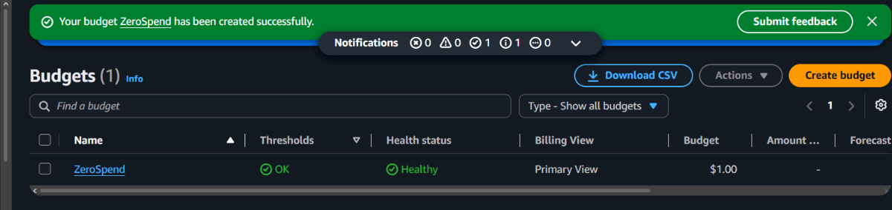

*Рисунок 1 — бюджет ZeroSpend в списке AWS Budgets.*

**Контрольные вопросы.** Политика `AdministratorAccess` позволяет выполнять почти все действия с ресурсами AWS, хотя дополнительные ограничения могут применяться на уровне аккаунта или организации. Root-пользователь обладает максимальными полномочиями, поэтому повседневная работа из-под него повышает риск серьёзных последствий при компрометации учётных данных. Для обычной работы предпочтителен отдельный пользователь или роль с необходимыми правами.

### Задание 2. Запуск экземпляра EC2

В регионе `eu-central-1` создан экземпляр `webserver` на Amazon Linux 2023 типа `t3.micro` с ключом ED25519 (`.pem`). Проверки состояния экземпляра завершились успешно; для входящего трафика настроены SSH с текущего внешнего IP и HTTP из интернета. Веб-сервер nginx был установлен **вручную через SSH** после запуска экземпляра, а не через требуемый в задании скрипт User data — это отдельное отклонение от инструкции.

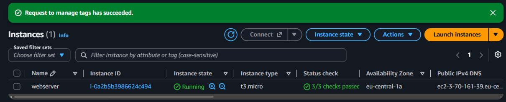

*Рисунок 2 — EC2 webserver: Running, t3.micro, 3/3 checks passed.*

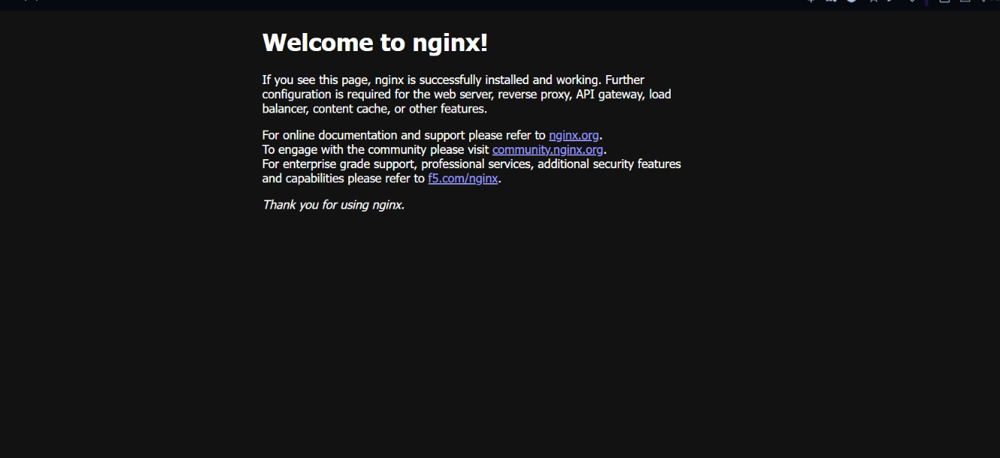

*Рисунок 3 — стандартная страница nginx по публичному IPv4 EC2.*

**Контрольные вопросы.** User data — скрипт начальной настройки экземпляра, который в Amazon Linux обычно выполняется `cloud-init` при первом запуске. По умолчанию такой скрипт не выполняется повторно при обычной перезагрузке, если явно не настроить иное поведение. **В этой работе автоматическая установка nginx через User data не была подтверждена**, поэтому при сдаче нельзя считать этот пункт выполненным полностью.

### Задание 3. Мониторинг и диагностика

В EC2 Console проверены `3/3 checks passed`, метрики CloudWatch CPU и сетевого трафика, системный журнал, а также снимок виртуального экрана. Обнаружен нормальный запуск Amazon Linux и завершение `cloud-init`; записей установки nginx из User data на предоставленном фрагменте нет, поскольку установка выполнялась вручную.

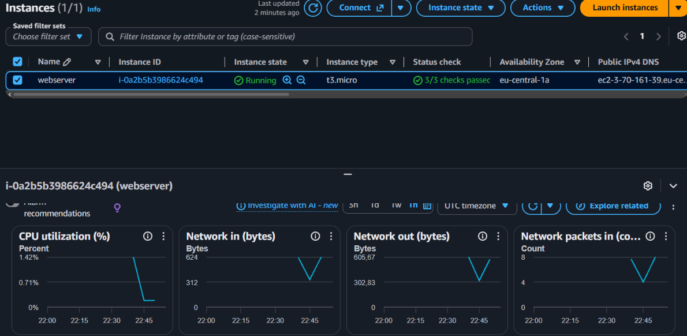

*Рисунок 4 — мониторинг CPU и сети экземпляра в CloudWatch.*

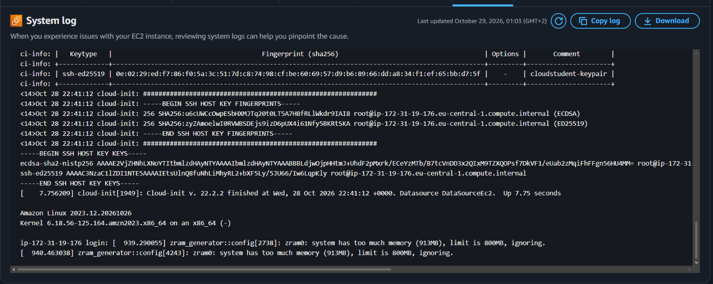

*Рисунок 5 — System log: сообщения `cloud-init` и запуска Amazon Linux.*

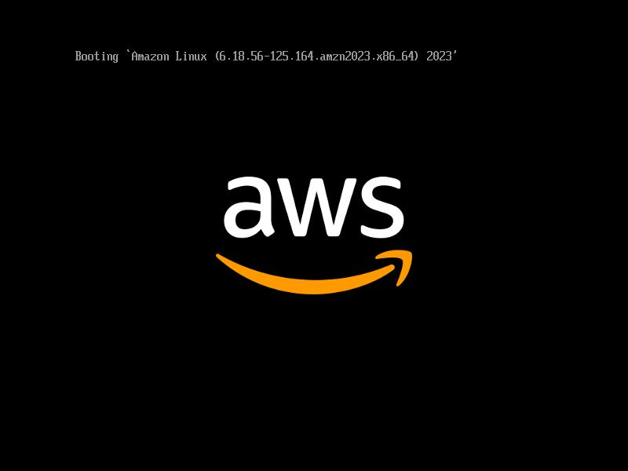

*Рисунок 6 — Instance screenshot: загрузочный экран Amazon Linux.*

**Контрольные вопросы.** `System status check` относится прежде всего к инфраструктуре AWS; `Instance status check` показывает проблемы внутри виртуальной машины, которые часто исправляет владелец экземпляра. `Attached EBS status check` сигнализирует о проблемах доступности подключённого хранилища, которые требуют отдельной диагностики. Детальный мониторинг раз в минуту полезен для кратковременных пиков и требований к быстрому реагированию, но создаёт дополнительные расходы.

### Задание 4. SSH

Со своего компьютера Windows выполнено подключение по SSH с помощью файла `cloudstudent-keypair.pem` от имени `ec2-user`. После входа проверена работа сервиса `nginx` командой `systemctl status nginx`.

```powershell
ssh -i "$HOME\.ssh\cloudstudent-keypair.pem" ec2-user@<актуальный-Public-IP>
```

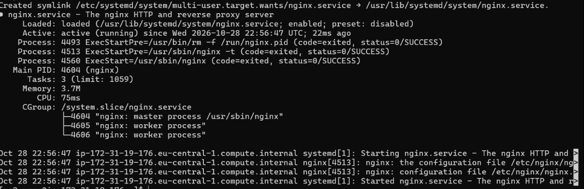

*Рисунок 7 — успешное подключение к EC2; nginx находится в состоянии `active (running)`.*

**Контрольный вопрос.** Пара ключей SSH подтверждает владение приватным ключом без передачи пароля по сети. Это позволяет отказаться от паролей для входа, снизить риск перебора и управлять доступом через отдельные ключи. Приватный файл `.pem` должен храниться только у владельца.

### Задание 5. Статический сайт

Подготовлены три страницы CloudLab: `index.html`, `about.html` и `contact.html`, связанные навигацией. Файлы отправлены на EC2 через защищённое копирование и опубликованы через nginx; все три страницы открывались в браузере по публичному IP.

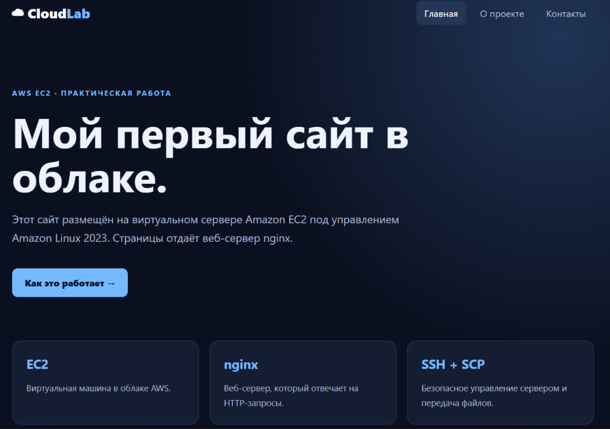

*Рисунок 8 — главная страница статического сайта CloudLab.*

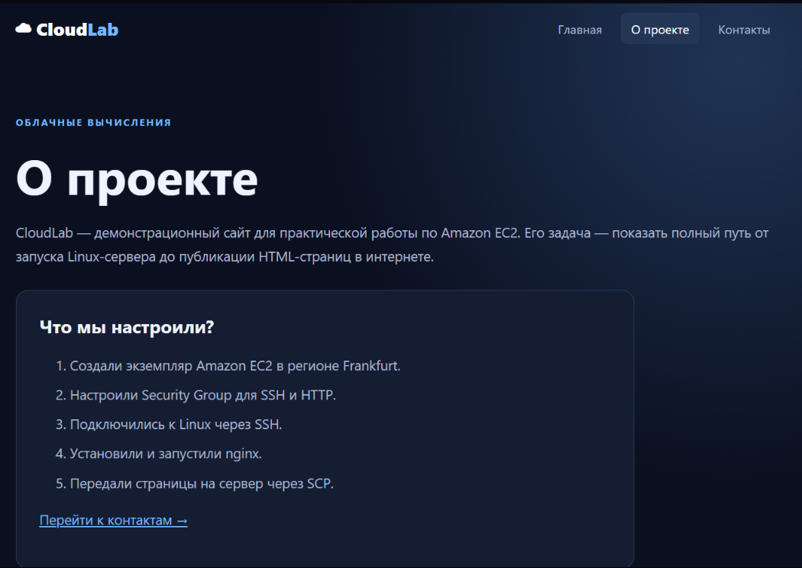

*Рисунок 9 — страница «О проекте».*

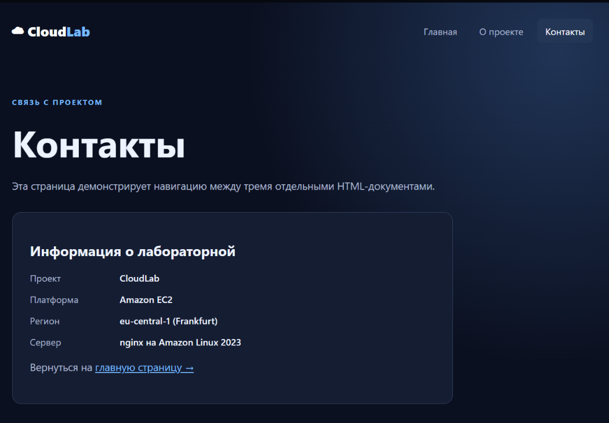

*Рисунок 10 — страница «Контакты».*

```bash
sudo cp ~/*.html /usr/share/nginx/html/
ls -l /usr/share/nginx/html/
```

**Контрольный вопрос.** `scp` копирует файлы между компьютерами через SSH с шифрованием передачи. Подобно `ssh`, он использует удалённого пользователя, адрес сервера и ключ; различие в том, что `ssh` открывает командную сессию, а `scp` переносит файлы. **Скриншот вывода `ls -l` не был предоставлен** и при необходимости его нужно снять дополнительно.

### Задание 6. Остановка через AWS CLI

В AWS CloudShell выполнена команда остановки экземпляра, а ответ API показал переход `running → stopping`.

```bash
aws ec2 stop-instances --instance-ids i-0a2b5b3986624c494 --region eu-central-1
```

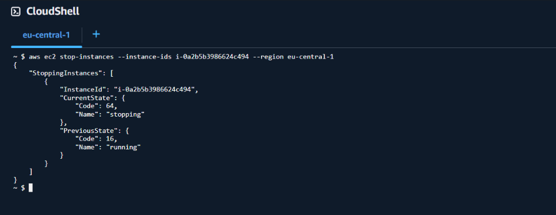

*Рисунок 11 — команда `aws ec2 stop-instances` и её результат в CloudShell.*

**Контрольный вопрос.** `Stop` останавливает вычисления, сохраняя экземпляр и его тома EBS, поэтому его можно запустить снова. `Terminate` удаляет экземпляр окончательно и может удалить корневой том в зависимости от настройки `DeleteOnTermination`. При остановке сохраняется плата за EBS, а также могут применяться начисления за выделенный публичный IPv4.

## Часть 2. Продвинутый уровень

### Задание 7. Организация и репозиторий GitHub

Создана GitHub-организация `cloudstudent-cloud` и публичный репозиторий `timecapsule`. В корень репозитория импортировано приложение `open_capsules_php_functional`, а первая версия отправлена через `git push` из PowerShell.

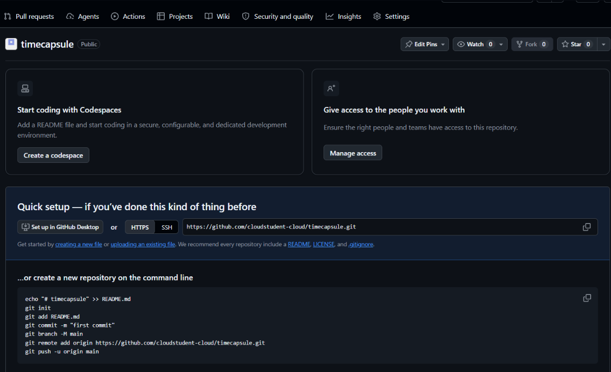

*Рисунок 12 — публичный репозиторий организации (до загрузки исходного кода).*

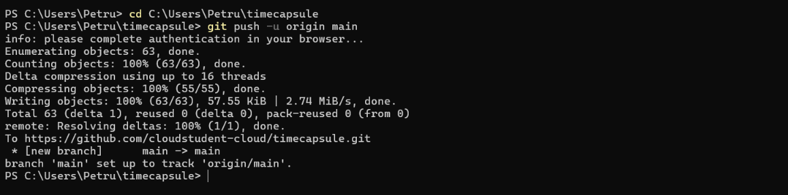

*Рисунок 13 — первая отправка ветки `main` на GitHub.*

**Контрольный вопрос.** `vendor/` содержит сторонние зависимости, устанавливаемые Composer по `composer.lock`, поэтому обычно не сохраняется в Git. `.env` содержит локальные настройки и пароль базы и также исключается из контроля версий посредством `.gitignore`. Публичный репозиторий не должен содержать действующих секретов, закрытых ключей и пользовательских данных.

### Задание 8. Программное обеспечение сервера

На том же EC2 установлены Git, Composer, PostgreSQL 16, PHP 8.4, PHP-FPM и PHP-модули. Проверены `php -v` и наличие расширения `pdo_pgsql`.

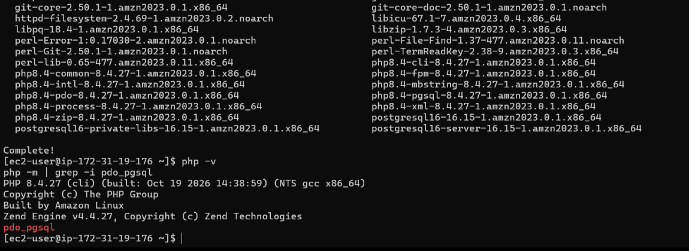

*Рисунок 14 — PHP 8.4.27 и модуль pdo_pgsql.*

**Контрольный вопрос.** Пакеты поставлены вручную, поскольку программное обеспечение для TimeCapsule устанавливалось на уже работающий сервер после базовой части. Такой подход позволяет пошагово диагностировать проблемы, хотя автоматизированный User data или конфигурационное управление были бы воспроизводимее для новых экземпляров.

### Задание 9. PostgreSQL

Создан кластер PostgreSQL, локальные TCP-методы `ident` заменены на `scram-sha-256`, затем создана БД `timecapsule` и пользователь `timecapsule`. Тест подключения по паролю завершился `SELECT 1` с результатом `1`.

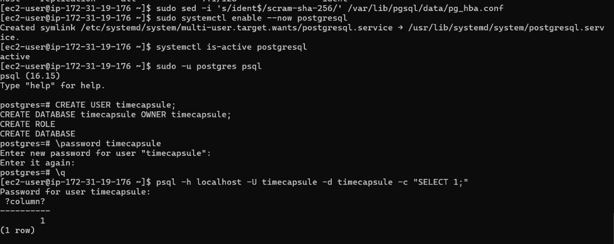

*Рисунок 15 — проверка соединения пользователя timecapsule с PostgreSQL.*

### Задание 10. Развёртывание приложения

Код получен сервером самостоятельно по HTTPS из GitHub в `/var/www/timecapsule`. Создан локальный `.env`, настроены права файла и папки `storage`, выполнены Composer и инициализация таблиц.

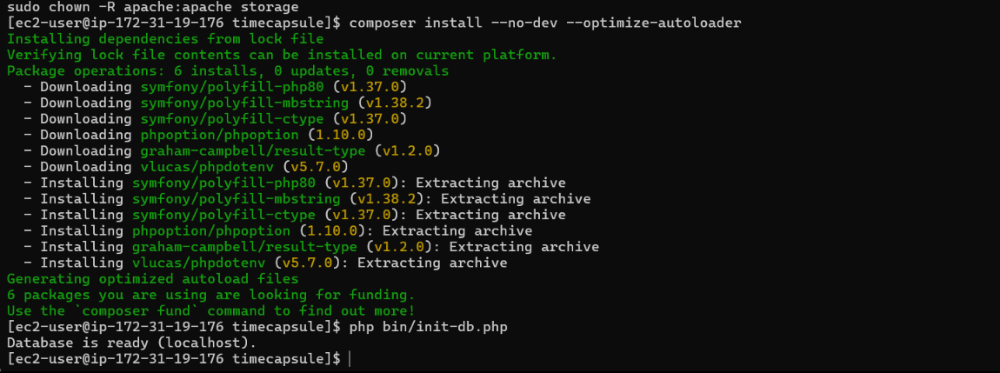

*Рисунок 16 — установка PHP-зависимостей и сообщение `Database is ready (localhost)`.*

**Контрольные вопросы.** Пароль PostgreSQL размещён в `.env` на сервере, чтобы секреты не попадали в публичную историю Git. GitHub здесь служит источником версий исходного кода: сервер читает публичный репозиторий без персональных учётных данных, а изменения отправляются с компьютера разработчика. Публичность кода сама по себе не гарантирует безопасность: важно не публиковать секреты, обновлять зависимости и защищать сервер.

### Задание 11. nginx и PHP-FPM

Для nginx задан корень `/var/www/timecapsule/public`; PHP-запросы пересылаются в PHP-FPM через Unix-сокет `/run/php-fpm/www.sock`. Приложение открывает форму входа, а `/health` возвращает `"status":"ok"` и `"db":"ok"`.

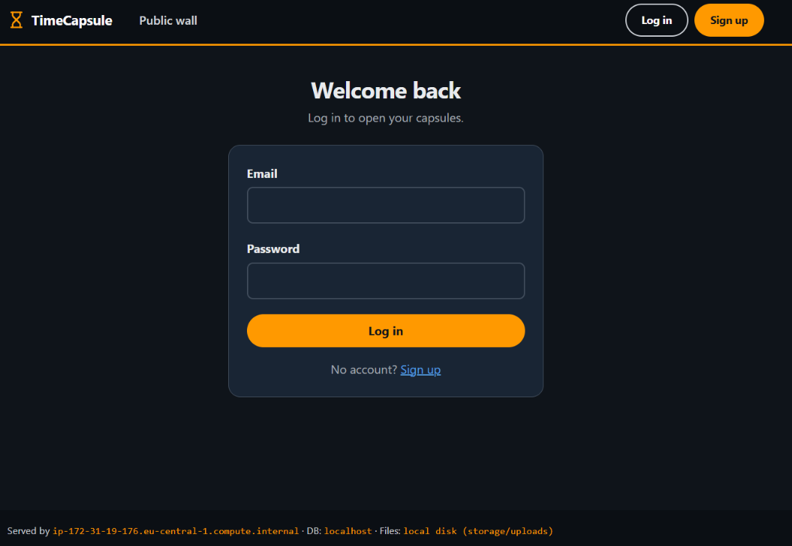

*Рисунок 17 — форма входа TimeCapsule после запуска приложения.*

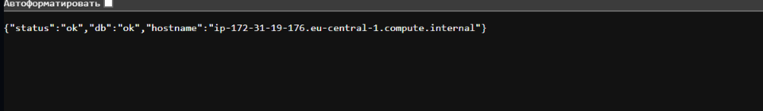

*Рисунок 18 — ответ `/health`, подтверждающий доступность обработчика и базы.*

> **Не хватает отдельного скриншота `sudo nginx -t`.** Работу сайта можно наблюдать, но формальное доказательство проверки синтаксиса nginx следует добавить.

### Задание 12. Ручной деплой (вариант A)

На EC2 выполнен ручной деплой по последовательности из учебного задания. До внесения новой версии `git pull` сообщал `Already up to date`, Composer не требовал обновления пакетов, а проверка БД завершилась успешно.

```bash
cd /var/www/timecapsule
git pull
composer install --no-dev --optimize-autoloader
php bin/init-db.php
sudo systemctl reload php-fpm
```

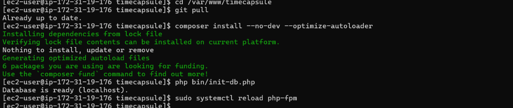

*Рисунок 19 — ручное обновление приложения на EC2 (вариант A).*

**Контрольные вопросы.** Во время `git pull` отдельные файлы могут уже относиться к новой версии, а остальные — к старой; пользователь в этот момент способен увидеть ошибку или несогласованный интерфейс. Если затем не выполнится `composer install`, новый код может потребовать библиотеки, которых ещё нет на сервере. Поэтому в реальной системе полезны тестирование, атомарный релиз и автоматический возврат предыдущей версии.

### Задание 13. Новая версия, ошибка 500, откат

На Windows изменён `views/layout.php`: добавлена строка `Developed by TAKED-OS | AWS Cloud Computing Lab 2026`. После `git push` на GitHub и `git pull` на EC2 строка появилась на сайте.

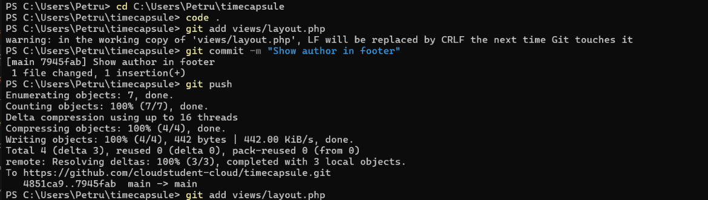

*Рисунок 20 — отправка изменения в GitHub.*

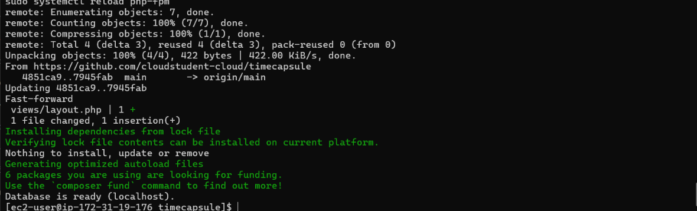

*Рисунок 21 — получение изменённого `views/layout.php` на EC2.*

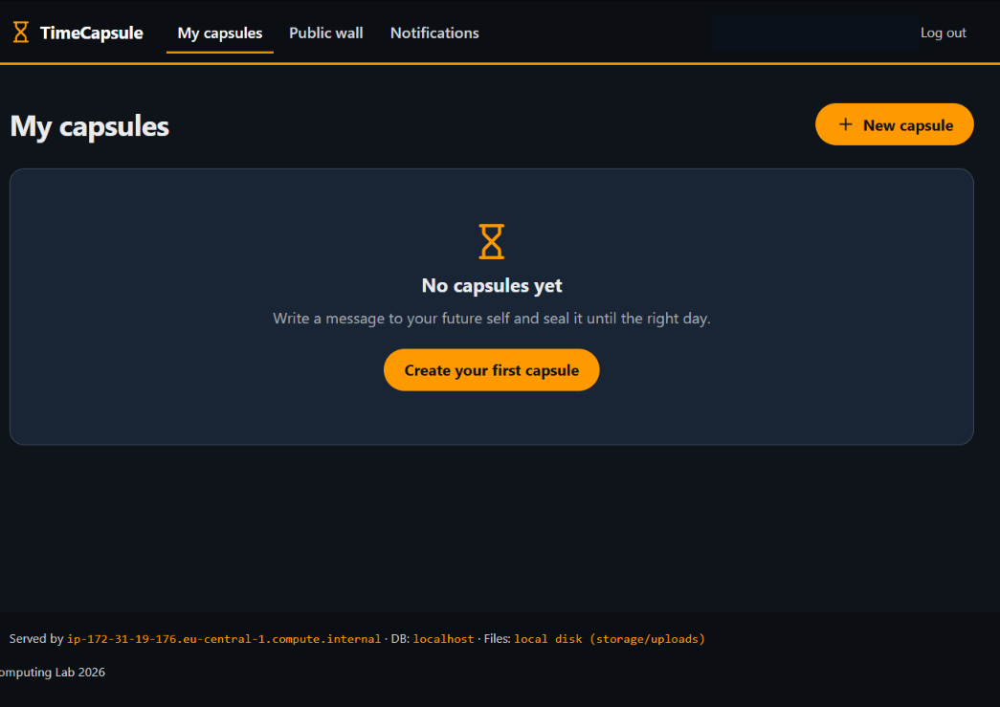

*Рисунок 22 — строка автора в нижней части TimeCapsule после деплоя.*

Далее в шаблон намеренно внесена синтаксическая ошибка PHP, что привело к HTTP 500. При этом `/health` продолжал возвращать `ok`: маршрут проверял лишь свою работоспособность и базу, не выполняя проблемный шаблон.

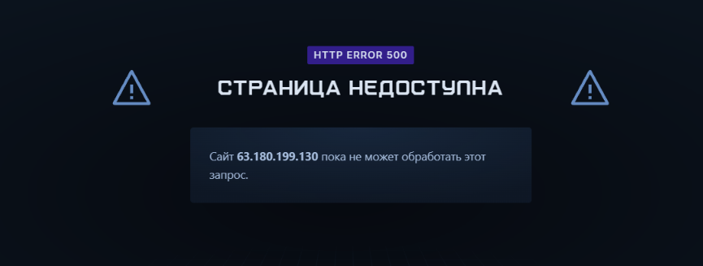

*Рисунок 23 — HTTP 500 после намеренно сломанного деплоя.*

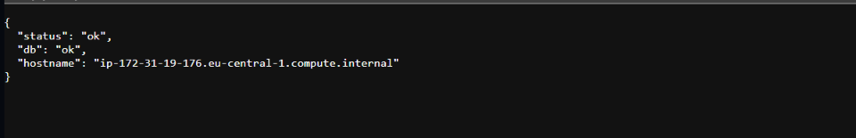

*Рисунок 24 — `/health` остаётся успешным во время ошибки главной страницы.*

На локальном компьютере выполнен откат ошибочного коммита через `git revert --no-edit HEAD`, после `git push` и повторного `git pull` сайт восстановился. Файл `.env` и надпись автора остались на месте.


*Рисунок 25 — восстановленная страница TimeCapsule после отката.*

**Контрольные вопросы.** `/health` проверяет свой обработчик и связь с БД, а не весь пользовательский интерфейс, поэтому может возвращать `ok` при ошибке конкретного PHP-шаблона. Время недоступности включает обнаружение ошибки, создание коммита отката, публикацию в GitHub, повторное получение кода на EC2 и проверку. **Точная длительность простоя не замерялась**, поэтому число минут не указывается. Время можно сократить автоматическими тестами, готовым предыдущим релизом, проверками интерфейса и атомарным переключением версий.

### Задание 14. Архитектура и ADR

Схема показывает использованные компоненты: Windows разработчика, GitHub, AWS Cloud и регион Frankfurt, default VPC, зону `eu-central-1a`, публичную подсеть, Security Group `launch-wizard-1` и экземпляр `webserver`. На нём размещены nginx, PHP-FPM, PostgreSQL и загруженные файлы; отдельные managed-сервисы БД или балансировщики не создавались.

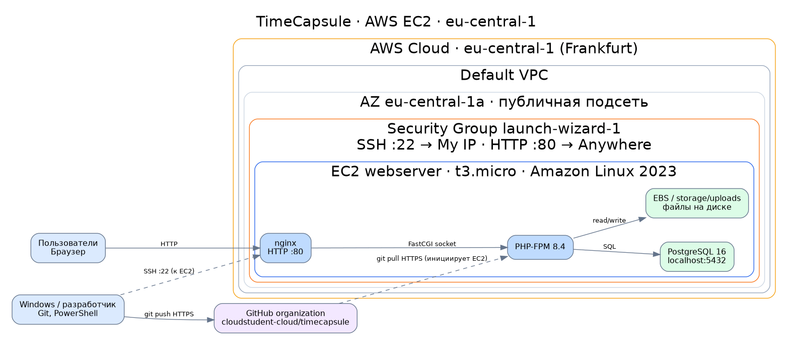

*Рисунок 26 — архитектура учебного развёртывания TimeCapsule на AWS EC2.*

**Исходный файл схемы:** [timecapsule-architecture.drawio](docs/architecture/timecapsule-architecture.drawio).  
**ADR:** [ADR-0001. Выбор ручного деплоя](docs/adr/0001-deploy-method.md).  
**Ссылка на ADR в GitHub:** https://github.com/cloudstudent-cloud/timecapsule/blob/main/docs/adr/0001-deploy-method.md

В ADR сравниваются три способа: `scp`, ручной `git pull` и `deploy.sh`. Для специальности Informatică aplicată выбран вариант A, который обеспечивает понятную историю изменений при минимальном числе инструментов.

## Дополнительные устные контрольные вопросы

**1. Как проходит запрос от браузера до БД?** Браузер отправляет HTTP-запрос на публичный IP EC2, порт 80; запрос получает nginx. Статические файлы nginx может отдать непосредственно, а PHP-запросы передаёт PHP-FPM через Unix-сокет. PHP при необходимости обращается к локальному PostgreSQL и формирует ответ, который nginx возвращает клиенту.

**2. Почему сервер может скачивать код, но не отправляет изменения?** Репозиторий публичный, поэтому для чтения по HTTPS не требуется авторизация GitHub. Для `git push` нужны полномочия записи, которых на EC2 намеренно не настраивали. Так сокращается ущерб при компрометации сервера.

**3. Что произойдёт с файлами при удалении EC2?** Файлы TimeCapsule хранятся на локальном диске EBS, который прикреплён к экземпляру. При `Stop` данные на EBS сохраняются, но при `Terminate` корневой EBS может удалиться автоматически согласно настройке `DeleteOnTermination`. Без резервной копии эти файлы могут быть безвозвратно потеряны.

**4. Что общего с CI/CD, чего не хватает?** В обоих случаях приложение получает версии из репозитория, устанавливает зависимости и выполняет действия по обновлению среды. Здесь всё запускается вручную, без автоматических тестов, проверки изменений, безопасного переключения релизов и уведомлений о неудачном деплое. В CI/CD эти этапы можно связать в воспроизводимый автоматический процесс.

## Итоговый вывод

Выполнено развёртывание веб-приложения на EC2 с nginx, PHP-FPM и PostgreSQL, а также получение новых версий с GitHub и возврат после ошибочного изменения. Практика показала разницу между исправным сервером и исправным приложением: успешный `/health` не исключает сбоя отдельных страниц. Для эксплуатации за пределами лабораторной необходимо добавить HTTPS, резервные копии, тестирование и более безопасную схему деплоя.

## Использованные источники

- Задание лабораторной работы «Amazon EC2 и machine identity», лекция 4 и Hands-on 4.1–4.3 (материалы курса).
- [AWS EC2 — User Guide](https://docs.aws.amazon.com/AWSEC2/latest/UserGuide/concepts.html).
- [AWS IAM — User Guide](https://docs.aws.amazon.com/IAM/latest/UserGuide/introduction.html).
- [AWS Budgets](https://docs.aws.amazon.com/cost-management/latest/userguide/budgets-managing-costs.html).
- [nginx Documentation](https://nginx.org/en/docs/).
- [Git documentation](https://git-scm.com/docs).
- [PostgreSQL Documentation](https://www.postgresql.org/docs/16/).
- [GitHub — app-samples](https://github.com/msu-cloud-course/app-samples).
